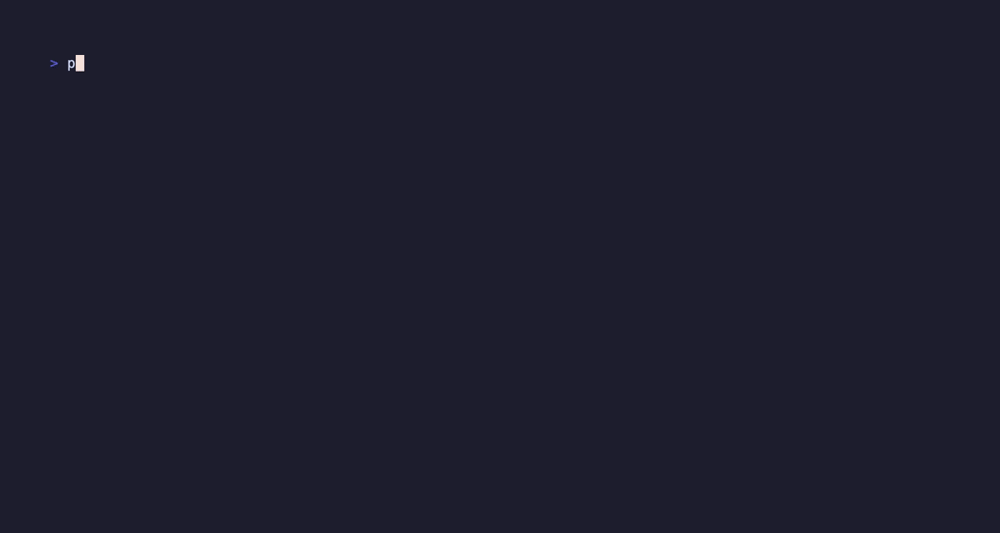
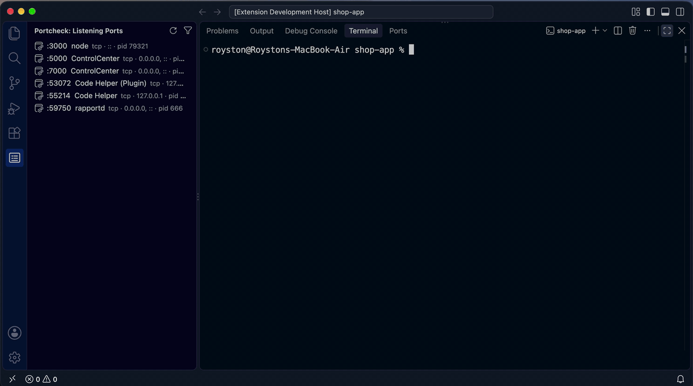
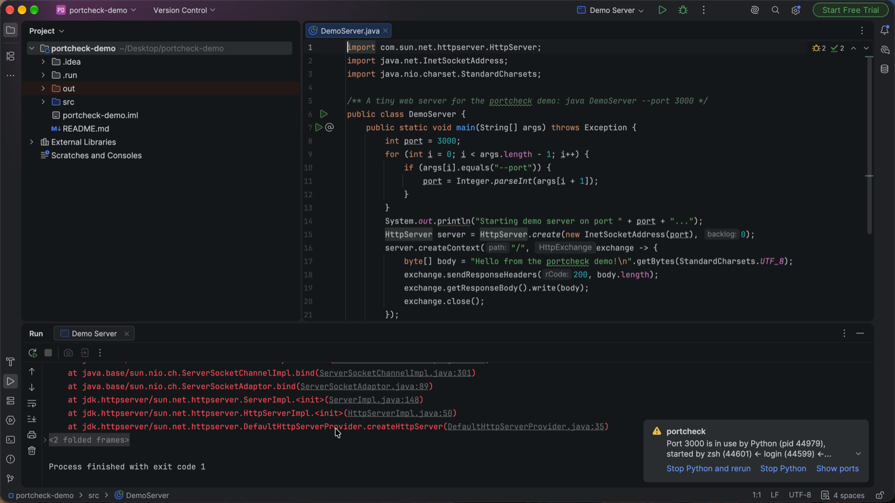

<h1 align="center">portcheck</h1>

<p align="center">
  <b>See what's using your ports, find free ones, free them up, and check remote hosts.</b><br>
  One static binary for macOS, Linux and Windows.
</p>

<p align="center">
  <a href="https://github.com/roystondwork-dev/portcheck/actions/workflows/ci.yml"></a>
  <a href="https://github.com/roystondwork-dev/portcheck/actions/workflows/codeql.yml"></a>
  <a href="https://codecov.io/gh/roystondwork-dev/portcheck"></a>
  <a href="https://github.com/roystondwork-dev/portcheck/releases/latest"></a>
  <a href="https://scorecard.dev/viewer/?uri=github.com/roystondwork-dev/portcheck"></a>
  <a href="https://www.bestpractices.dev/projects/15848"></a>
  <a href="https://pkg.go.dev/github.com/roystondwork-dev/portcheck"></a>
  <a href="LICENSE"></a>
</p>

<p align="center"></p>

## Features

| | Command | |
|---|---|---|
| 🔍 | `portcheck list -l` | Every listening socket with its process, PID and user |
| ✅ | `portcheck 3000` | Is the port free? If not, who holds it? Exit code 0 or 1 for scripts |
| 🆓 | `portcheck free 3000-3999 -n 3` | Free ports, verified by actually binding them |
| 🛑 | `portcheck kill 8080` | Graceful SIGTERM, then SIGKILL; refuses PID 1, your shell and system processes |
| 📡 | `portcheck scan db.internal -p 5432` | Rate-limited TCP connect checks of remote hosts. No root needed |
| ⏳ | `portcheck wait db:5432 -t 60s` | Block until services accept connections, or until a port is free. Built for CI |
| ▶️ | `portcheck run --port 3000 --next -- npm run dev` | Start a command on a free port (`$PORT`, `{port}`); take the next one or stop the holder |
| 🩺 | `portcheck doctor` | Check the ports listed in `.portcheck.yaml` and get a fix for each problem |
| 🖥️ | `portcheck` | Live, sortable, filterable TUI. Stop processes without leaving it |
| 🌐 | [Browser extension](https://microsoftedge.microsoft.com/addons/detail/jenlahoamefdpfmpodhidkgcceikheee) | Edge (and Chrome): which process serves a localhost tab, `off` when nothing listens, stop it from the popup ([guide](docs/guide/browser.md)) |
| 🧩 | [VS Code extension](https://marketplace.visualstudio.com/items?itemName=portcheck-vscode.portcheck-vscode) | "Port in use" errors in the terminal become one-click fixes; listening ports in the sidebar ([guide](docs/guide/vscode.md)) |
| 🤖 | `portcheck mcp` | AI assistants (Claude Code, Cursor, Copilot…) check and free ports themselves ([guide](docs/guide/mcp.md)) |
| ⌨️ | [Raycast](docs/guide/raycast.md) | Search Ports, Check Port, Kill Port and Find Free Port from the Mac launcher |
| ✍️ | [Neovim](docs/guide/neovim.md) | `:Portcheck` picker, check/kill/free, and "port in use" in `:terminal` → stop it |
| 🔌 | [Menu bar / tray app](docs/guide/tray.md) | Your listening ports in the macOS menu bar or Windows/Linux tray: stop, open, copy in two clicks |
| 🧠 | [JetBrains plugin](docs/guide/jetbrains.md) | IntelliJ IDEA, WebStorm, PyCharm, GoLand…: "port in use" in Run/Debug → **Stop it and rerun**; a Ports tool window |

### VS Code extension

When a dev server fails because its port is taken, the extension says who holds it and
fixes it: stop it and re-run, or re-run on the next free port.



Install **Portcheck - Port in Use Fixer** from the
[VS Code Marketplace](https://marketplace.visualstudio.com/items?itemName=portcheck-vscode.portcheck-vscode) (search "portcheck" in VS Code) or
[Open VSX](https://open-vsx.org/extension/portcheck-vscode/portcheck-vscode) (VSCodium, Cursor, Windsurf). portcheck is built in.

### JetBrains plugin

In IntelliJ IDEA, WebStorm, PyCharm, GoLand and the other JetBrains IDEs, when a run
configuration fails because its port is taken, a notification names the process and
offers **Stop it and rerun**; the **Ports** tool window lists every listening port.

▶ [Watch the 20-second demo](https://youtu.be/k0laz2xCaPs)



Install `portcheck-jetbrains-<version>.zip` from the
[latest release](https://github.com/roystondwork-dev/portcheck/releases/latest)
(**Settings → Plugins → ⚙ → Install Plugin from Disk…**); it is in review on JetBrains Marketplace
([guide](docs/guide/jetbrains.md)).

### Browser extension

On every localhost tab, a badge names the process serving it, or says `off` when nothing
is listening; the popup shows who started it and stops it safely.


Install **Portcheck - Localhost Port Inspector** from
[Microsoft Edge Add-ons](https://microsoftedge.microsoft.com/addons/detail/jenlahoamefdpfmpodhidkgcceikheee), then run `portcheck browser install` once.
For Chrome, Brave and Chromium, load the zip from the
[latest release](https://github.com/roystondwork-dev/portcheck/releases/latest)
([guide](docs/guide/browser.md)).

### Highlights

- **Same commands and output on every OS.** It replaces `lsof -i`, `netstat -ano`, `ss -ltnp` and `kill`.
- **Built for scripts.** `--json` follows a [versioned schema](docs/json-schema.md), [exit codes](docs/exit-codes.md) are stable, and results go to stdout while messages go to stderr.
- **Container- and WSL-aware.** Ports published by Docker/Podman or forwarded from WSL show the container or distro, and `kill` tells you how to stop it there instead of killing the proxy.
- **Honest about permissions.** Hidden owners are shown as hidden, with a hint on how to see them.
- **A Go library too.** See [`pkg/`](https://pkg.go.dev/github.com/roystondwork-dev/portcheck).

## Install

```sh
# Homebrew (macOS, Linux)
brew install roystondwork-dev/tap/portcheck

# winget (Windows; the package is waiting for Microsoft's review)
winget install roystondwork-dev.portcheck

# Scoop (Windows)
scoop bucket add portcheck https://github.com/roystondwork-dev/scoop-bucket
scoop install portcheck

# npm (any OS): run it without installing
npx portcheck-cli 3000

# PyPI (any OS)
pipx install portcheck-tool

# Go 1.26+
go install github.com/roystondwork-dev/portcheck/cmd/portcheck@latest
```

`.deb`, `.rpm`, `.apk` and archives for amd64/arm64 are on the
[releases page](https://github.com/roystondwork-dev/portcheck/releases). The
checksum file covering every artifact is signed with cosign (keyless), and
releases ship SBOMs and SLSA provenance; see
[verifying downloads](docs/install.md#verifying-downloads).

## Quickstart

```console
$ portcheck 3000
PORT  PROTO  STATUS  PID    PROCESS  USER
3000  tcp    in-use  42379  node     alice

$ portcheck kill 3000
About to terminate:
  PID 42379  node  (port 3000)
Proceed? [y/N] y
PID    PROCESS  RESULT      DETAIL
42379  node     terminated

$ portcheck free 3000-3999 -n 2 -o plain
PORT
3000
3001

$ portcheck list -l --json | jq '.data.sockets[] | {port: .localPort, name: .process.name}'
```

📖 **Documentation:** <https://roystondwork-dev.github.io/portcheck/>
([quickstart](docs/quickstart.md) · [guides](docs/guide/) · [CLI reference](docs/commands/portcheck.md) · [permissions by OS](docs/permissions.md) · [FAQ](docs/faq.md))

## Use as a Go library

```go
res, err := inspect.NewSystem().List(ctx, inspect.Filter{Ports: portspec.Single(3000), ListeningOnly: true})
if err != nil {
	log.Fatal(err)
}
for _, s := range res.Sockets {
	if s.Process != nil { // nil when the owner is hidden from your user
		fmt.Println(s.PID, s.Process.Name)
	}
}
```

See the [library guide](docs/library.md) for `portspec`, `inspect`, `freeport`, `killer`, `scan`, `waitfor` and `containers`.

## Responsible use

`portcheck scan` makes ordinary TCP connections and has no stealth features. Only
scan hosts and networks you own or are authorized to test.

## Contributing

Contributions are welcome! See [CONTRIBUTING.md](CONTRIBUTING.md) for setup and
standards (every change is tested on Linux, macOS and Windows, with a 100% coverage
gate on the library), and [TASKS.md](TASKS.md) for the roadmap and status.
Please follow the [Code of Conduct](CODE_OF_CONDUCT.md), and report vulnerabilities
privately as described in [SECURITY.md](SECURITY.md).

## License

[MIT](LICENSE) © 2026 Royston D and portcheck contributors
