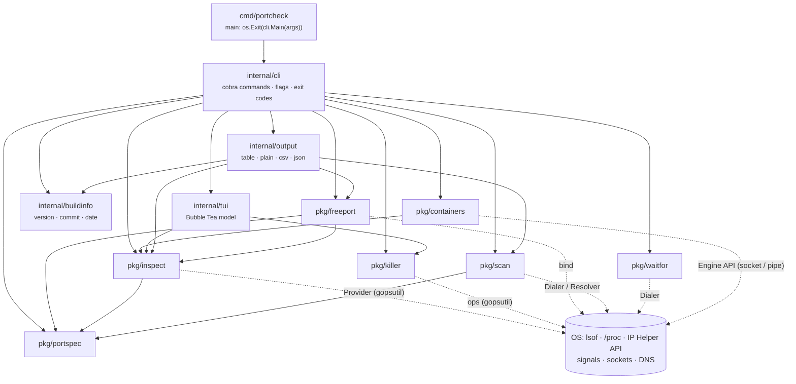
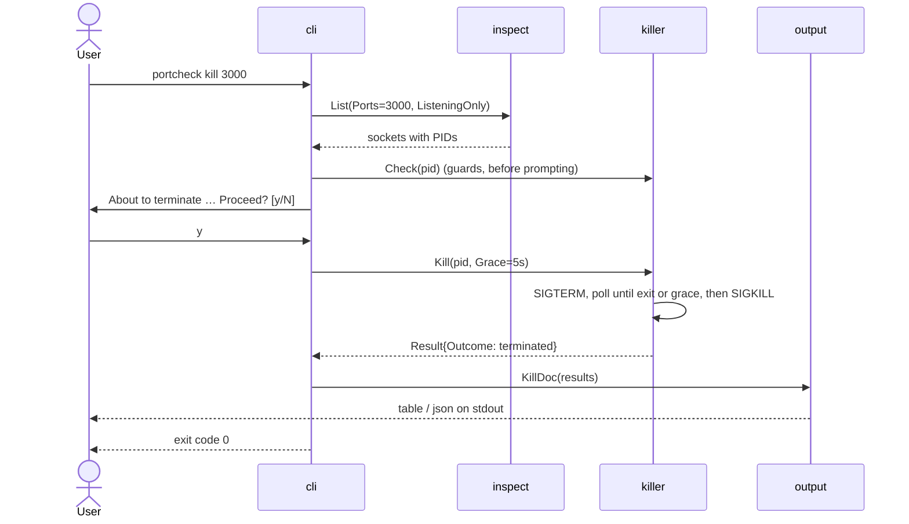

# Architecture

## Layers

**Dependencies point down only.** `pkg/*` is the public library and must not import
`internal/*`, cobra or the Charm libraries; `depguard` in `.golangci.yml` enforces this.

## Packages

| Package | Responsibility | OS boundary (faked in tests) |
|---|---|---|
| `pkg/portspec` | Parse, normalize and iterate port sets | none |
| `pkg/inspect` | Filter, de-duplicate, enrich and sort sockets | `Provider` (gopsutil; [ADR-0001](adr/0001-gopsutil-provider.md)) |
| `pkg/freeport` | Free = no visible listener **and** bindable on 4 addresses | `Lister`, `bind` func |
| `pkg/killer` | Guards → SIGTERM → wait → SIGKILL | `ops` interface |
| `pkg/scan` | Target expansion, worker pool, rate limit, classification | `Dialer`, `Resolver` |
| `pkg/waitfor` | Poll a condition until it holds or the context ends | `Check`, `Dialer` |
| `pkg/containers` | Map published ports to containers; implements `inspect.Enricher` | Engine API over a socket (faked with an HTTP server in tests) |
| `internal/output` | Render a `Document` (JSON payload + toned rows) in 4 formats | writer |
| `internal/buildinfo` | Version, commit and date from `-ldflags` or Go's embedded build info | `debug.ReadBuildInfo` |
| `internal/tui` | Pure model; I/O happens in `tea.Cmd`s | `Lister`, `Killer` |
| `internal/cli` | Arguments → library calls → `Document` → exit code | `App` struct |

## Data flow: `portcheck kill 3000`

## Design principles

- **Every OS call sits behind a small interface.** This keeps business logic
  deterministic and testable without root, real processes or a network; real
  behavior is covered separately by integration tests on all three OSes.
- **Commands are thin.** They parse flags, call `pkg/*`, build an `output.Document`
  and map errors to [exit codes](exit-codes.md). They contain no business logic.
- **One `Document`, four formats.** Commands never print directly, so table, plain,
  CSV and JSON output can't drift apart. JSON follows a [versioned schema](json-schema.md).
- **Errors are sentinel-wrapped** (`inspect.ErrAccessDenied`, `killer.ErrProtected`,
  `scan.ErrTooManyHosts`, …), so callers and the CLI branch with `errors.Is`.
- **Safe defaults:** confirmation before killing, guards that run before prompting,
  rate-limited scans and host caps.

## Testing strategy

See [Development & testing](development.md).
