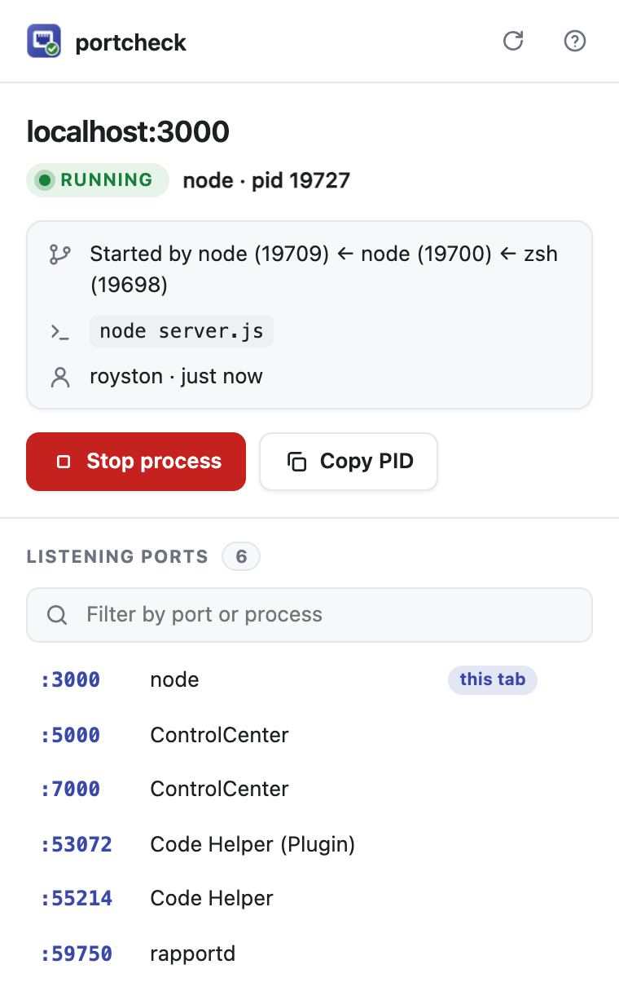

# Browser extension

The portcheck extension for **Chrome and Edge** (and Chromium, Brave) tells you which
process serves the localhost page you're looking at, and what's wrong when localhost
refuses to connect.

{ width="360" }

!!! note "Status"
    The extension isn't in the Chrome Web Store or Edge Add-ons yet (M17 in
    [TASKS.md](https://github.com/roystondwork-dev/portcheck/blob/main/TASKS.md)). Until
    then, install it from a release as below.

## What it does

- **A badge on localhost tabs.** `node` (or `java`, `pyth`, `web` for a container…) shows
  what serves the page; hover for the process, its PID and who started it
  (`npm ← zsh`). **`off`** in red means nothing is listening: the server isn't running,
  so "This site can't be reached" isn't a network problem.
- **The popup** shows the details: who started the process, its command and user, or
  for a Docker/Podman/WSL port the command that stops it. **Stop** asks first, then
  stops the process with portcheck's [safety guards](kill.md#safety): it never stops
  system processes or the browser itself. Below, every port listening on the machine,
  one click to open.

It works on `localhost`, `*.localhost`, `127.0.0.1`, `[::1]` and `0.0.0.0`, on any port.

## Install

1. Download `portcheck-browser-<version>.zip` from the
   [latest release](https://github.com/roystondwork-dev/portcheck/releases/latest) and
   unzip it into a folder you'll keep (the browser loads the extension from there).
2. Open `chrome://extensions` (Edge: `edge://extensions`), turn on **Developer mode**,
   click **Load unpacked** and choose that folder.

## Setup

The extension asks the `portcheck` program on your machine, through the browser's
[native messaging](https://developer.chrome.com/docs/extensions/develop/concepts/native-messaging).
Connect them once:

1. [Install portcheck](../install.md) (0.7 or later).
2. Run:

    ```sh
    portcheck browser install
    ```

    This registers portcheck with every supported browser installed for your user;
    `--browser edge` picks one. No administrator rights are needed. Check with
    `portcheck browser status`; undo with `portcheck browser uninstall`.

If the popup says *Connect portcheck to this browser*, step 2 hasn't been done for this
browser (or portcheck moved: run it again).

## Troubleshooting

- **The popup says "Connect portcheck to this browser".** Run `portcheck browser install`
  (again, if portcheck moved or was installed differently), then reopen the popup.
- **macOS asks "portcheck would like to access files in your Desktop folder"** (or
  Documents, Downloads). The registered portcheck binary lives in that folder, for
  example a build from source; the browser waits for your answer before the badge can
  appear. Click **Allow**, or register a copy outside those folders
  (`portcheck browser install --path /usr/local/bin/portcheck`). Package-manager
  installs (Homebrew, Scoop) aren't affected.
- **No badge on a localhost tab.** The badge only appears once the page has loaded;
  reload it. `portcheck browser status` shows whether this browser is registered.

## Privacy and permissions

- The extension can only read the address of **localhost** tabs; it can't see other
  sites, and it has no access to page content.
- It can ask portcheck for exactly four things: its version, the listening ports,
  whether one port is in use, and to stop one process. portcheck refuses anything else.
  Nothing leaves your machine.

## Building from source

Requires Go 1.26+ and Node.js 22+.

```sh
git clone https://github.com/roystondwork-dev/portcheck.git && cd portcheck
make build                       # bin/portcheck (needs the browser commands)
bin/portcheck browser install --path "$PWD/bin/portcheck"
cd extensions/browser && npm ci && npm run build
```

Then in Chrome open `chrome://extensions` (Edge: `edge://extensions`), turn on
**Developer mode**, click **Load unpacked** and choose `extensions/browser/dist`.
