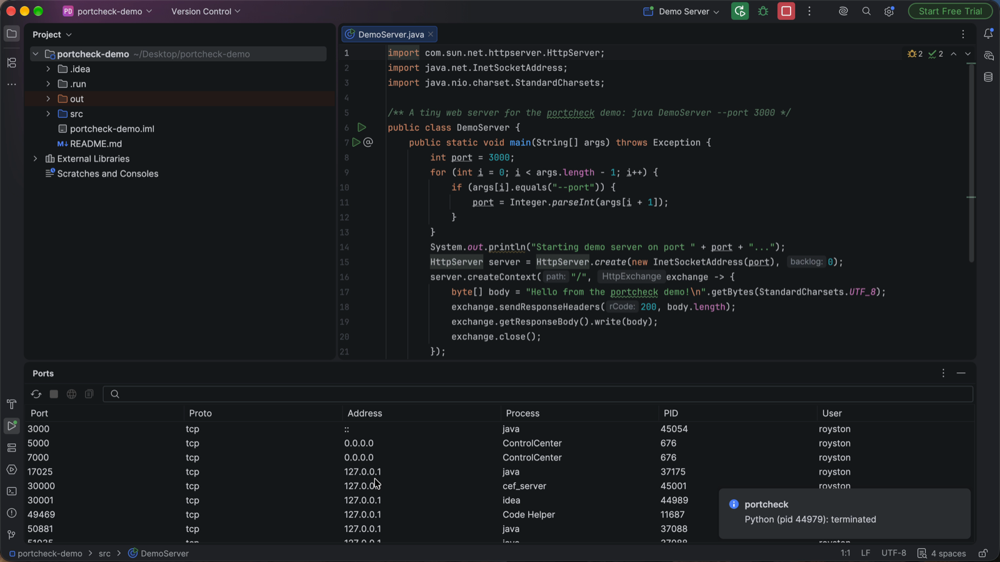

# JetBrains plugin

The portcheck plugin brings the same fixes to **IntelliJ IDEA, WebStorm, PyCharm,
GoLand, PhpStorm, RubyMine, Rider, CLion and Android Studio** (2025.2 or later). portcheck
is built in.

## Install

!!! note "Status"
    The plugin is on its way to [JetBrains Marketplace](https://plugins.jetbrains.com/).
    Until it's listed, install it from a release.

Download `portcheck-jetbrains-<version>.zip` from the
[latest release](https://github.com/roystondwork-dev/portcheck/releases/latest), then in
the IDE open **Settings → Plugins → ⚙ → Install Plugin from Disk…** and choose the zip.
It carries portcheck for macOS, Linux and Windows (x64 and arm64) and uses the right
one. The zip has build provenance:
`gh attestation verify <file> --repo roystondwork-dev/portcheck`.

## "Port in use" in Run/Debug: stop it and rerun

When a run configuration fails because its port is taken, the plugin names the process
that holds it and offers the fix:

▶ [Watch the 20-second demo on YouTube](https://youtu.be/k0laz2xCaPs)


```text
Web server failed to start. Port 8080 was already in use.

 ⚠ portcheck
   Port 8080 is in use by java (pid 41852), started by idea (1203).
   Stop java and rerun · Stop java · Show ports
```

**Stop … and rerun** stops that process (after portcheck's
[safety checks](kill.md#safety): never system processes or the IDE itself) and runs the
same configuration again. It recognises the errors of Node.js, Spring Boot, Tomcat,
Go, Python (Django, Flask, uvicorn), Ruby, PHP, .NET, Deno, Rust, Bun, Vite, Next.js,
Angular, Create React App, Docker, nginx, Redis and PostgreSQL. A port published by
Docker, Podman or WSL gets **Copy stop command** instead, since stopping the container
runtime would affect every container.

Turn it off in **Settings → Tools → portcheck**.

## The Ports tool window

**View → Tool Windows → Ports** lists every listening port with its process, PID and
user.


 Filter by port, process or user; select a row to **Stop** it (after confirming),
**Open in Browser** (or double-click) or **Copy PID**; **Refresh** reloads.

## Actions

Under **Tools → portcheck**, and in **Find Action** (⇧⌘A / Ctrl+Shift+A):

- **Check a Port…**: free, or which process holds it.
- **Find a Free Port…**: the first free port in a range, copied to the clipboard.
- **Stop What's Using a Port…**: stops the holder after confirming.

## Settings

**Settings → Tools → portcheck**: the path to a portcheck binary (empty: the built-in
one, or portcheck on `PATH`), and whether to watch Run/Debug consoles.
