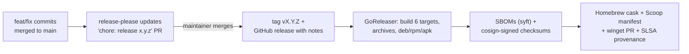

# Releasing

Releases are automated. Maintainers only merge a pull request.



## How versions are chosen

[release-please](https://github.com/googleapis/release-please) reads the
[Conventional Commit](https://www.conventionalcommits.org/) titles merged since the
last release:

| Commits since last release | Before 1.0.0 | From 1.0.0 |
|---|---|---|
| only `fix:` / `perf:` | patch | patch |
| any `feat:` | **minor** | minor |
| any `!` / `BREAKING CHANGE:` | **minor** | **major** |

`CHANGELOG.md` and the release notes are generated from the same commits; `docs:`
and `build:` commits are listed too, while `test:`, `ci:`, `refactor:` and `chore:`
are hidden.

## Cutting a release

1. Merge the open **"chore: release x.y.z"** pull request after reviewing its changelog.
2. The **Release** workflow tags `vX.Y.Z`, creates the GitHub release and runs GoReleaser.
3. Check that the release has its archives, packages, `checksums.txt`,
   `checksums.txt.sigstore.json` and `*.sbom.json` files, and that the
   [tap](https://github.com/roystondwork-dev/homebrew-tap) and
   [bucket](https://github.com/roystondwork-dev/scoop-bucket) received commits.
4. Smoke-test: `brew install roystondwork-dev/tap/portcheck && portcheck version`.
5. Check that the release has `portcheck-vscode-X.Y.Z.vsix`. The **vscode** job
   verifies the signed `checksums.txt`, puts the binary for every platform into one
   extension package (`bin/<platform>-<arch>/`; the extension picks its own at runtime),
   attaches it, and publishes it to the VS Code Marketplace and Open VSX when their
   tokens are set. Without `VSCE_PAT`, upload that one file on
   [the Marketplace's management page](https://marketplace.visualstudio.com/manage)
   (**⋯ → Update**). The extension's version comes
   from the same release PR (`extra-files` in `release-please-config.json`).
6. Check that the release has `portcheck-browser-X.Y.Z.zip`, the browser extension
   built by the **browser** job (its version also comes from the release PR).
7. Follow the winget pull request opened on
   [microsoft/winget-pkgs](https://github.com/microsoft/winget-pkgs/pulls?q=is%3Apr+roystondwork-dev.portcheck).
   Microsoft's bots validate and scan it, then a moderator merges it, which can take a few
   days the first time. Keep the fork's `master` branch in sync occasionally
   (`gh repo sync roystondwork-dev/winget-pkgs`).

To rebuild artifacts for an existing tag (for example, after fixing a publishing
problem), run the **Release** workflow manually and enter the tag. Tick **vscode_only**
to only package and publish the VS Code extension: the extension from the branch the
workflow runs on (usually `main`), with the portcheck binaries from that tag's release.
Its `package.json` version must equal the tag's.

## Repository secrets

| Secret | Required | Purpose |
|---|---|---|
| `HOMEBREW_TAP_GITHUB_TOKEN` | for Homebrew/Scoop | Fine-grained PAT with **Contents: read & write** on `homebrew-tap` and `scoop-bucket`. Without it, those publishers are skipped with a warning. |
| `WINGET_GITHUB_TOKEN` | for winget | **Classic** PAT with the `public_repo` scope. GoReleaser pushes the manifest to the [`winget-pkgs` fork](https://github.com/roystondwork-dev/winget-pkgs) and opens a PR to `microsoft/winget-pkgs`; fine-grained tokens can't open PRs on repositories you don't own. Without it, the winget submission is skipped with a warning. |
| `RELEASE_PLEASE_TOKEN` | recommended | Fine-grained PAT with **Contents** and **Pull requests: read & write** on this repo. PRs opened with the default `GITHUB_TOKEN` don't trigger CI, so required checks never run on the release PR. Without this token, a maintainer must merge the release PR with admin override. |
| `VSCE_PAT` | for the VS Code Marketplace | Azure DevOps personal access token with the **Marketplace: Manage** scope for *All accessible organizations*, from the account that owns the `portcheck-vscode` publisher. Without it, Marketplace publishing is skipped with a warning. |
| `OVSX_PAT` | for Open VSX | Access token from [open-vsx.org](https://open-vsx.org) (user settings), for the account that owns the `portcheck-vscode` namespace and has signed the publisher agreement. Without it, Open VSX publishing is skipped with a warning. |
| `CODECOV_TOKEN` | optional | Coverage upload; the coverage gate doesn't depend on it. |

!!! note "Without `RELEASE_PLEASE_TOKEN`"
    New repositories don't allow workflows to open pull requests with the default
    token, so release-please fails with *"GitHub Actions is not permitted to create or
    approve pull requests"*. Either set `RELEASE_PLEASE_TOKEN` (recommended), or enable
    *Settings → Actions → General → Allow GitHub Actions to create and approve pull requests*.

The first release is `0.1.0` (`initial-version` in `release-please-config.json`).

Signing needs no secret: cosign uses the workflow's GitHub OIDC identity
(keyless), and users verify against that identity; see
[verifying downloads](install.md#verifying-downloads).

## Local dry run

```sh
make snapshot   # builds everything into dist/ without publishing or signing
```

This needs `goreleaser` and, for SBOMs, `syft` (`brew install goreleaser syft`).
