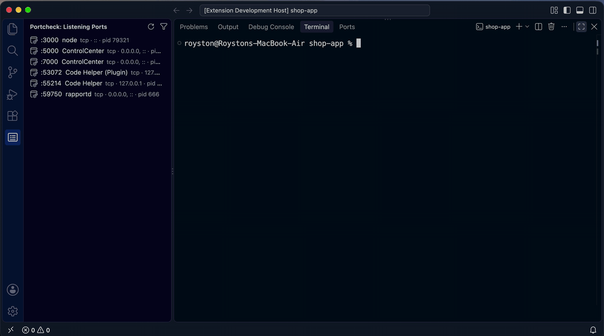
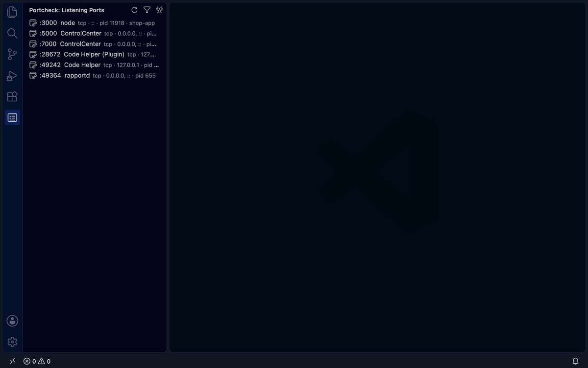

# Portcheck - Port in Use Fixer

See what's using your ports, and free them safely, without leaving the editor.

- **"Port in use" → fixed in one click.** When `npm run dev`, `rails s`,
  `python -m http.server`, `go run .` (and many more) fail because the port is taken,
  you're told who holds it and can **stop it and re-run**, or **re-run on the next free
  port**, from the terminal.
- **Project ports**: with a `.portcheck.yaml`, the status bar and Problems show which of
  your project's ports are blocked, and how to fix them.
- **Listening ports** view: every listening port with its process, who started it
  (`node ← npm ← zsh`), and the Docker/Podman container or WSL distro behind it.
- **Stop** a process from the view or the command palette. You confirm first, and
  portcheck's safety guards apply: it never stops system processes or VS Code itself.
- Container and WSL ports show the right command (`docker stop web`) instead of killing
  the proxy.
- **Check a port** and **find a free port** from the command palette.
- **Network Tools** panel: type a host and ports to see what holds them on this machine,
  or which accept connections on another host, and **Watch** them to hear when they
  change; see your project's `.portcheck.yaml` ports; look up domains and IPs; see your
  addresses and the devices on your network. Every result has a Copy button.

  
- Works in Remote-SSH, WSL and Dev Containers: it runs where your code runs.

The extension runs the [portcheck](https://github.com/roystondwork-dev/portcheck) CLI,
which is built in for macOS, Linux and Windows (x64 and arm64). To use another copy, set
**portcheck.path**. Needs VS Code 1.98 or later.

Documentation: <https://roystondwork-dev.github.io/portcheck/guide/vscode/>
